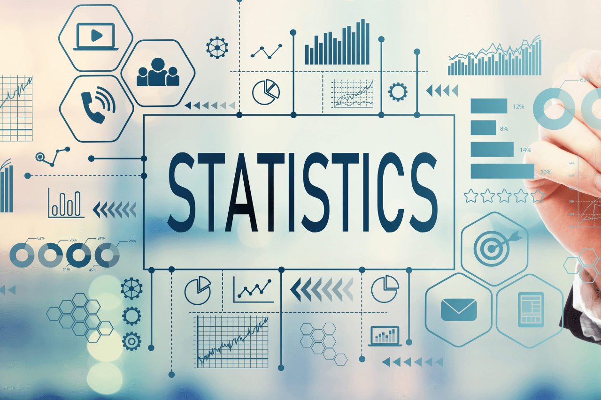

<h1 align="center">De la donnée à la décision</h1>
<h3 align="center">Statistiques pour les Experts Data — Formation complète</h3>

<p align="center">
  
</p>

<p align="center">
  <a href="https://github.com/bassambhamed/stats-data-experts"></a>
  
  
  
  
  
</p>

> Formation orientée pratique pour data analysts, data scientists et data engineers. On part de la donnée brute, on traverse statistiques descriptives, probabilités, inférence et séries temporelles, et on finit par la communication des résultats — celle qui transforme une analyse en **décision**.

---

## Sommaire

- [Sommaire](#sommaire)
- [Pourquoi cette formation](#pourquoi-cette-formation)
- [Public visé](#public-visé)
- [Approche pédagogique](#approche-pédagogique)
- [Structure du repo](#structure-du-repo)
- [Installation \& utilisation](#installation--utilisation)
  - [Prérequis](#prérequis)
  - [Installer les dépendances Python](#installer-les-dépendances-python)
  - [Lancer un notebook](#lancer-un-notebook)
  - [Consulter une partie de slides](#consulter-une-partie-de-slides)
- [Programme — 5 parties, 17 modules](#programme--5-parties-17-modules)
  - [Partie 1 — Statistiques descriptives *(3h45)*](#partie-1--statistiques-descriptives-3h45)
  - [Partie 2 — Probabilités *(2h00)*](#partie-2--probabilités-2h00)
  - [Partie 3 — Statistiques inférentielles *(6h15)*](#partie-3--statistiques-inférentielles-6h15)
  - [Partie 4 — Séries temporelles *(4h45)*](#partie-4--séries-temporelles-4h45)
  - [Partie 5 — Synthèse \& bonnes pratiques *(1h15)*](#partie-5--synthèse--bonnes-pratiques-1h15)
- [Dataset fil rouge](#dataset-fil-rouge)
  - [Utilisation par partie](#utilisation-par-partie)
- [Volume horaire](#volume-horaire)
- [Auteur](#auteur)
- [Licence](#licence)

---

## Pourquoi cette formation

Beaucoup de cours de statistiques s'arrêtent aux formules. Beaucoup de cours de data analysis s'arrêtent au code. **Cette formation fait le pont :** chaque concept théorique est suivi de son implémentation Python, puis d'une cellule d'**interprétation business** — *« que dit ce résultat au responsable produit / supply chain / direction ? »*.

Les formules sont présentes mais accompagnées d'une explication composant par composant. Pas de démonstration formelle : on vise le *quand* et le *comment lire*, pas le *pourquoi mathématique*.

---

## Public visé

- **Data analysts** souhaitant solidifier leurs bases statistiques.
- **Data scientists juniors** voulant ré-ancrer leurs modèles ML dans la rigueur statistique.
- **Data engineers** ou **product managers data** qui interagissent avec des analystes et veulent lire un résultat sans contresens.
- Toute personne qui produit ou consomme des **chiffres pour aider une décision**.

Pré-requis : Python de base (pandas, matplotlib), pas besoin de bagage statistique formel.

---

## Approche pédagogique

| Principe | Mise en œuvre |
|---|---|
| **Quand utiliser** > **comment démontrer** | Toute formule s'accompagne d'un cas business |
| **Interprétation systématique** | Cellule dédiée après chaque résultat |
| **Pièges fréquents** explicités | p-hacking, corrélation $\neq$ causalité, fuite temporelle… |
| **Baselines obligatoires** | Tout modèle doit battre une naïve avant d'exister |
| **Validation rigoureuse** | Split temporel + rolling origin sur les séries |
| **Incertitude affichée** | Intervalles de confiance et de prédiction systématiques |

---

## Structure du repo

```
stats-data-experts/
├── README.md                              # ce fichier
├── statistics.png                         # visuel d'illustration
│
├── slides/                                # supports PDF (Beamer 16:9, thème metropolis)
│   ├── 01_stats_descriptives.pdf          # Partie 1 — M0 à M3
│   ├── 02_probabilites.pdf                # Partie 2 — M4 et M5
│   ├── 03_stats_inferentielles.pdf        # Partie 3 — M6 à M10
│   ├── 04_series_temporelles.pdf          # Partie 4 — M11 à M15
│   └── 05_synthese_bonnes_pratiques.pdf   # Partie 5 — M16 et M17
│
└── tp/                                    # notebooks Jupyter compagnons
    ├── 01_stats_descriptives.ipynb
    ├── 02_probabilites.ipynb
    ├── 03_stats_inferentielles.ipynb
    ├── 04_series_temporelles.ipynb
    └── dataset/                           # Pharmaceutical Sales Data (Kaggle)
        ├── salesdaily.csv
        ├── saleshourly.csv
        ├── salesweekly.csv
        ├── salesmonthly.csv
        └── description.md
```

---

## Installation \& utilisation

### Prérequis

- **Python 3.10+** avec les bibliothèques listées ci-dessous (pour exécuter les notebooks).

### Installer les dépendances Python

```bash
pip install pandas numpy matplotlib seaborn scipy statsmodels scikit-learn prophet pmdarima jupyter
```

> `prophet` et `pmdarima` ne sont nécessaires que pour la Partie 4 (séries temporelles).

### Lancer un notebook

```bash
cd tp
jupyter notebook 01_stats_descriptives.ipynb
```

### Consulter une partie de slides

```bash
open slides/01_stats_descriptives.pdf      # macOS
xdg-open slides/01_stats_descriptives.pdf  # Linux
```

---

## Programme — 5 parties, 17 modules

### Partie 1 — Statistiques descriptives *(3h45)*

> **Décrire ce qu'on a sous les yeux.**

| # | Module | Durée | Contenu clé |
|---|---|---|---|
| M0 | Introduction \& cadrage | 30 min | Vocabulaire, types de variables, cycle d'analyse |
| M1 | Décrire une variable | 1h30 | Tendance centrale, dispersion, asymétrie, boxplot |
| M2 | Visualiser une distribution | 45 min | Histogramme, KDE, reconnaissance visuelle des lois |
| M3 | Relations entre variables | 1h30 | Pearson / Spearman, eta², V de Cramér, paradoxe de Simpson |

### Partie 2 — Probabilités *(2h00)*

> **Le langage de l'incertitude.**

| # | Module | Durée | Contenu clé |
|---|---|---|---|
| M4 | Vocabulaire probabiliste | 1h | Variable aléatoire, probabilité conditionnelle, espérance / variance |
| M5 | Lois usuelles | 1h | Bernoulli, binomiale, Poisson, normale, log-normale, exponentielle, odds |

### Partie 3 — Statistiques inférentielles *(6h15)*

> **Généraliser depuis un échantillon.**

| # | Module | Durée | Contenu clé |
|---|---|---|---|
| M6 | Échantillon → population | 1h | TCL, erreur standard, intervalle de confiance |
| M7 | Logique des tests d'hypothèses | 1h | H0/H1, p-value comme probabilité conditionnelle, types I/II, puissance |
| M8 | Choisir le bon test | 2h | t-test, ANOVA, Mann-Whitney, $\chi^2$, Wilcoxon, arbre de décision |
| M9 | Régression linéaire | 1h30 | Coefs, $R^2$, multicolinéarité, lecture d'un summary statsmodels |
| M10 | Régression logistique | 45 min | Logit, odds ratio, AUC, seuil de décision |

### Partie 4 — Séries temporelles *(4h45)*

> **Quand le temps compte.**

| # | Module | Durée | Contenu clé |
|---|---|---|---|
| M11 | Spécificités des séries temporelles | 45 min | Tendance, saisonnalité, bruit ; additif vs multiplicatif |
| M12 | Exploration \& préparation | 1h | Resampling, valeurs manquantes, moyennes mobiles, EWMA |
| M13 | Stationnarité \& autocorrélation | 1h | ADF, KPSS, différenciation, ACF / PACF |
| M14 | Modèles de prévision | 2h | Baselines, Holt-Winters, **SARIMA**, **Prophet**, métriques, intervalles |
| M15 | Détection d'anomalies | 1h | Z-score sur rolling, STL + résidus, communication au métier |

### Partie 5 — Synthèse \& bonnes pratiques *(1h15)*

> **Transformer l'analyse en décision.**

| # | Module | Durée | Contenu clé |
|---|---|---|---|
| M16 | Communiquer ses résultats | 45 min | Pyramide d'audience, incertitude, viz qui trompent, checklist |
| M17 | Récapitulatif \& arbre de décision | 30 min | Quel outil pour quelle question, cheatsheets, 10 commandements |

---

## Dataset fil rouge

**Pharmaceutical Sales Data** *(Kaggle / Milan Sulc — « Sales of pharmaceutical products »)*

- **Période :** 6 ans de données (2014–2019).
- **Granularités :** horaire, journalière, hebdomadaire, mensuelle.
- **Variables :** ventes de **8 catégories ATC** (Anatomical Therapeutic Chemical) :
  - **M01AB / M01AE** — anti-inflammatoires (AINS)
  - **N02BA / N02BE** — antalgiques (aspirine, paracétamol)
  - **N05B / N05C** — anxiolytiques / hypnotiques
  - **R03** — médicaments contre l'asthme
  - **R06** — antihistaminiques

**Pourquoi ce dataset.** Saisonnalités très visibles (R06 antihistaminiques au printemps, R03 asthme à l'automne, antalgiques en hiver) → idéal pour SARIMA et Prophet. Permet aussi des analyses descriptives, probabilistes et inférentielles riches.

### Utilisation par partie

| Partie | Mise en pratique sur le dataset |
|---|---|
| Descriptive | Distribution par catégorie, comparaison de dispersion, corrélations (antalgiques ↔ AINS), effet jour de la semaine |
| Probabilités | Ajustement empirique : Poisson sur catégories rares, normale sur agrégats mensuels, manipulation `scipy.stats` |
| Inférentielle | IC sur la moyenne mensuelle, tests « week-end vs semaine », ANOVA inter-catégories, régression logistique « jour de forte vente » |
| Séries temporelles | STL, ACF/PACF, **SARIMA** $(P,D,Q,12)$ et **Prophet**, comparaison côte à côte sur R06 et N02BE, détection d'anomalies |

---

## Volume horaire

| Partie | Durée |
|---|---|
| Introduction | 0h30 |
| Statistiques descriptives | 3h45 |
| Probabilités | 2h00 |
| Statistiques inférentielles | 6h15 |
| Séries temporelles | 4h45 |
| Synthèse \& bonnes pratiques | 1h15 |
| **Total** | **~18h30** *(2,5 jours pleins ou 5 demi-journées)* |

---

## Auteur

**Bassem Ben Hamed**
[bassem.benhamed@enetcom.usf.tn](mailto:bassem.benhamed@enetcom.usf.tn)

Pour toute remarque, suggestion ou correction : [ouvrir une issue](https://github.com/bassambhamed/stats-data-experts/issues).

---

## Licence

- **Code et supports pédagogiques** (slides, notebooks, scripts) — sous licence permissive (à préciser : MIT recommandé).
- **Dataset Pharmaceutical Sales** — auteur original Milan Zdravković, **CC BY-NC 4.0**. Usage non commercial uniquement.

---

<p align="center"><sub>De la donnée à la décision — Statistiques pour les Experts Data</sub></p>
